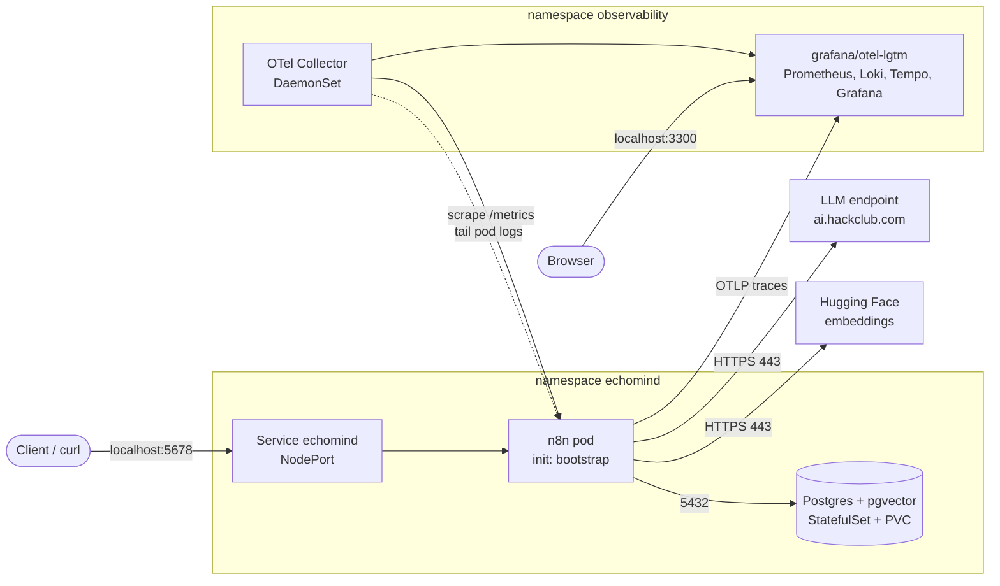
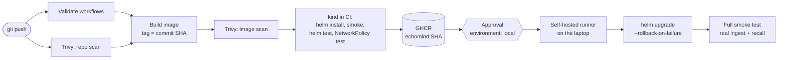

# Architecture

## Components

| Component | Kubernetes object | Purpose |
|---|---|---|
| n8n | Deployment `echomind` (1 replica, `Recreate`), container `n8n`, label `app.kubernetes.io/component=n8n` | Runs the EchoMind workflows: webhooks, chat, LLM calls |
| Bootstrap | Init container `bootstrap` in the n8n pod | Waits for Postgres, imports credentials and workflows, and publishes the active workflows, before n8n starts |
| Postgres + pgvector | StatefulSet `echomind-postgres` (`pgvector/pgvector:pg17`) with a 2 Gi PersistentVolumeClaim, label `app.kubernetes.io/component=database` | Database `n8n` (n8n's own state) and database `echomind` (memories, vectors, error log, owned by a separate role) |
| Secrets | `echomind-api-keys`, `echomind-db`, `echomind-encryption-key` | API keys from `.env` (via `make secrets`); database passwords and n8n's encryption key generated in the cluster and kept across upgrades and uninstalls |
| Network policies | `echomind-n8n`, `echomind-postgres` | n8n: inbound 5678; outbound only to Postgres, DNS, the collector and port 443 outside private ranges. Postgres: inbound only from n8n, no outbound |
| Observability | Namespace `observability`: `grafana/otel-lgtm:0.36.0`, OpenTelemetry Collector DaemonSet (`otel/opentelemetry-collector-contrib:0.162.0`) | Metrics, logs, traces, dashboard, alerts |
| External services | none (internet) | OpenAI-compatible LLM endpoint (Hack Club AI) and Hugging Face embeddings |

The namespace `echomind` enforces the Pod Security Standard `restricted`. Every pod in it runs as non-root, with a read-only root filesystem, all capabilities dropped and no service account token. n8n still needs a few writable folders, so the pod mounts `emptyDir` volumes at `/home/node/.n8n` (settings), `/tmp` and `/home/node/.cache` (n8n compiles its editor assets there at start-up). All lasting state is in Postgres.

The collector in `observability` is the exception: it reads the node's pod log files, which belong to root, so it runs as uid 0, with no capabilities, no privilege escalation, a read-only root filesystem and a read-only mount of `/var/log/pods`.

## Runtime

### Start-up sequence

1. The `bootstrap` init container runs `docker/bootstrap.sh` from the same image.
2. It waits up to 180 s for Postgres to accept TCP connections. On the first install, Postgres is still running `initdb`, and without this wait the init container crash-looped.
3. `render-credentials.js` builds the credentials from environment variables that come from Kubernetes Secrets. `n8n import:credentials` stores them encrypted with `N8N_ENCRYPTION_KEY`, and the temporary file is deleted.
4. `n8n import:workflow --separate` loads every file in `workflows/` (overwritten by workflow ID, so the database always matches the image).
5. `n8n publish:workflow` activates the IDs in `n8n.activeWorkflows`: ingest, recall, error logger and health check. Email triage stays off.
6. The n8n container starts. A startup probe gives it up to 3 minutes (database migrations after an upgrade). Liveness probes `/healthz`; readiness probes `/healthz/readiness`, which only passes when the database is connected and migrated.

n8n's settings come from the ConfigMap `echomind`: Postgres connection, `N8N_WEBHOOK_URL`/`N8N_EDITOR_BASE_URL` (`http://localhost:5678/`), JSON logs (`N8N_LOG_FORMAT=json`), metrics with workflow ID and name labels, OTLP traces (`N8N_OTEL_ENABLED`, off in CI), environment access blocked inside nodes, and a 7-day execution history.

## Request paths

### Ingest: `POST /webhook/b3f32965-eaf7-4301-82ca-1945d8ff2de5`

1. The webhook checks the `X-EchoMind-Token` header; if it's wrong → `403`.
2. `If`: is `transcript` present? If not → `400`.
3. LLM call 1 detects the emotion and a confidence value. `If1` keeps the emotion when confidence ≥ 0.6; otherwise it marks it "uncertain".
4. LLM call 2 classifies the topic. LLM call 3 writes a 2–3 sentence summary.
5. In parallel:
   - **Save memory**: a parameterised `INSERT` into `memories`.
   - **Store embedding**: the memory's fields (speaker, transcript, emotion, topic, summary) are loaded as documents, embedded with Hugging Face (384 dimensions) and inserted into `memory_vectors` (pgvector). In our test, 2 memories produced 10 vector rows.
6. **Wait for both stores**, then reply `201 {"status":"stored", "speaker", "summary"}`.
7. If any node fails, the webhook replies `500` and the error logger writes a row to `workflow_errors`.

### Recall: `POST /webhook/9216b954-b7b0-44b2-b57a-bfd45c8940ea/chat`

1. The chat trigger checks basic auth (user `echomind`); without it → `401`.
2. LLM call 1 parses the intent (speaker, search type).
3. **Search memories**: the question is embedded and the top 3 matches come from `memory_vectors`.
4. The matches are aggregated, and LLM call 2 answers using only those memories.
5. The response is `200 {"text": "..."}`.

## Delivery

The image that reaches the laptop is exactly the one that passed the scans and the CI deployment. The chart is checked out from the same commit, so a release is one commit.

## Data

| Store | Where | Contents | Survives |
|---|---|---|---|
| Database `n8n` | Postgres PVC | Workflows, encrypted credentials, execution history | Pod restarts and redeploys |
| Database `echomind` | Postgres PVC | `memories`, `memory_vectors`, `workflow_errors` | Pod restarts and redeploys |
| Workflows and credentials | Image and Secrets | Source of truth, re-imported at every start | Loss of the database (re-imported automatically) |

## Failure boundaries

| Failure | What users see | What keeps working | How we detect it |
|---|---|---|---|
| LLM endpoint down or out of credits | Ingest and recall return `500` | n8n stays Ready; the health check works; stored memories are intact | Failure-ratio alert; rows in `workflow_errors`; failed spans in Tempo; error lines in Loki |
| Hugging Face down | Ingest and recall return `500` at the embedding step. The parallel `memories` insert may already have been written, so a retry can create a duplicate row | Same as above | Same as above |
| Postgres down | Readiness fails, the pod leaves the Service, and new connections are refused. Liveness does not check the database, so n8n is not restarted in a loop | Nothing data-related | "n8n down" alert (the scrape fails); pod `READY 0/1` |
| n8n container crash | Short outage while Kubernetes restarts it | Data in Postgres | "n8n down" alert; restart count |
| Bad release (pod never becomes Ready) | With `Recreate`, the old pod is stopped before the new one starts, so n8n is down until Helm rolls back, up to the 8-minute `--timeout`. A rolling update would have kept the old pod serving; we accept this cost to avoid two n8n instances (see DECISIONS #2) | Data; the previous image is restored automatically | Failed deploy job; "n8n down" alert; `helm history` shows the failed revision and the rollback |
| Bad workflow logic (healthy but wrong) | Wrong answers or `500`s | Platform | Failure-ratio alert; smoke test after deploy; roll back by redeploying the previous SHA |
