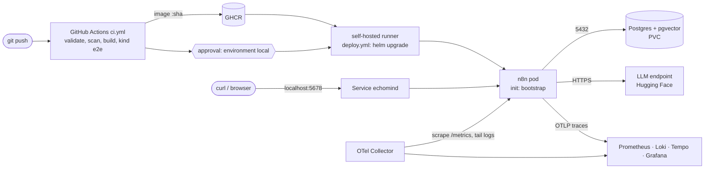

# Architecture

## Components

| Component | Kubernetes object | Purpose |
|---|---|---|
| n8n | Deployment `echomind` (1 replica, `Recreate`), init container `bootstrap` | Runs the workflows. `bootstrap` waits for Postgres, imports credentials and workflows from the image, publishes the active ones |
| Postgres + pgvector | StatefulSet `echomind-postgres` with a 2 Gi PVC | Database `n8n` (n8n state) and database `echomind` (memories, vectors, error log; separate role) |
| Secrets | `echomind-api-keys`, `echomind-db`, `echomind-encryption-key` | API keys from `.env` via `make secrets`; DB passwords and the encryption key generated in the cluster and kept |
| Network policies | `echomind-n8n`, `echomind-postgres` | n8n: in on 5678; out only to Postgres, DNS, the collector and 443 outside private ranges. Postgres: in only from n8n |
| Observability | Namespace `observability`: `grafana/otel-lgtm`, OpenTelemetry Collector DaemonSet | Metrics, logs, traces, dashboard, alerts |
| External | Internet (HTTPS) | LLM endpoint (Hack Club AI), Hugging Face embeddings |

Namespace `echomind` enforces the `restricted` Pod Security Standard: non-root, read-only root filesystem (with `emptyDir` for `/home/node/.n8n`, `/tmp`, `/home/node/.cache`), no capabilities, no service account token.

## Runtime and delivery

## Request paths

**Ingest** (`POST /webhook/b3f32965-…`, header `X-EchoMind-Token`): validate the token and the transcript → three LLM calls (emotion, topic, summary) → in parallel, insert into `memories` and embed into `memory_vectors` → reply `201` with the summary. Any failure → `500`, and the error logger writes to `workflow_errors`.

**Recall** (`POST /webhook/9216b954-…/chat`, basic auth): parse the question with the LLM → search `memory_vectors` (top 3) → the LLM answers from those memories → `200 {"text": …}`.

## Failure boundaries

| Failure | What users see | How we detect it |
|---|---|---|
| LLM endpoint down or out of credits | Ingest/recall return `500`; n8n stays Ready | Log-based alert "a webhook execution failed" (Loki); rows in `workflow_errors`; failed spans in Tempo |
| Hugging Face down | `500` at the embedding step (the `memories` row may already exist) | Same as above |
| Postgres down | n8n fails readiness and leaves the Service; requests fail fast; no restart loop | "n8n not answering metrics scrapes" alert; pod `0/1` |
| n8n crash | Short outage while Kubernetes restarts it | Scrape alert; restart count |
| Bad release (never Ready) | Downtime until Helm rolls back (about 151 s in the demo) | Failed deploy job; `helm history` shows the failed revision and the rollback |
